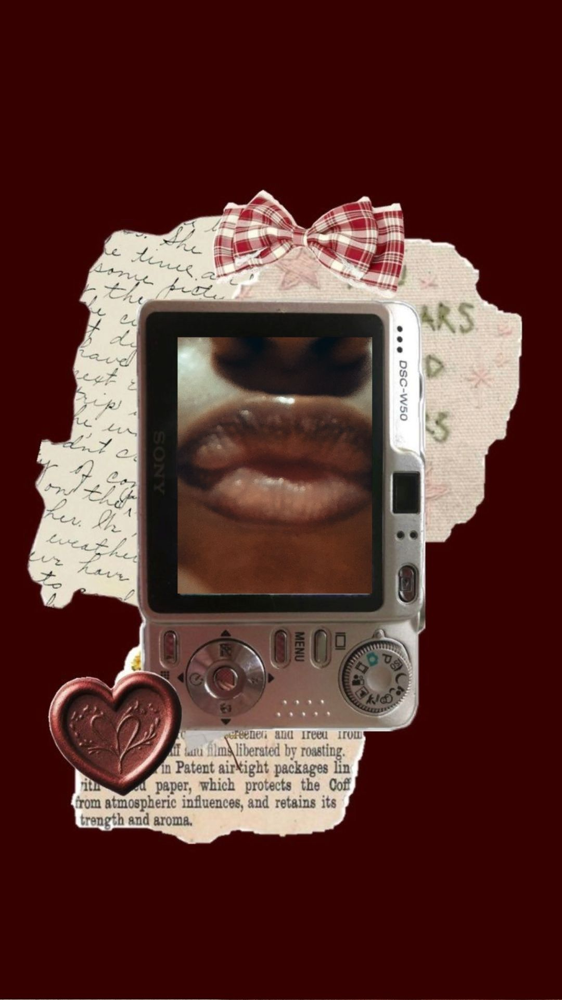
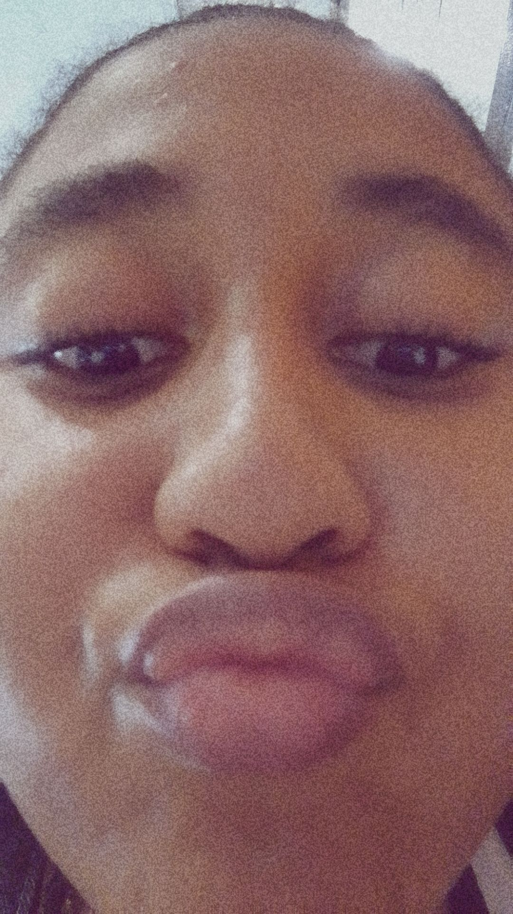
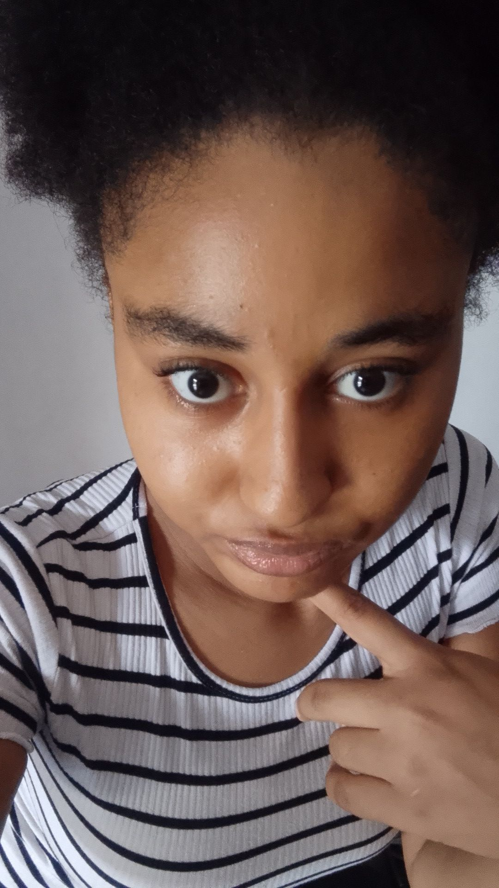

<!DOCTYPE html>
<html lang="en">
<head>
<meta charset="UTF-8">
<meta name="viewport" content="width=device-width, initial-scale=1.0">
<meta name="theme-color" content="#210b13">
<title>for bernice ♡</title>

</head>
<body>

<button class="music-pill" id="musicBtn" onclick="toggleMusic()">♫ music: off</button>
<audio id="song" loop></audio>

<section class="screen active" id="s0">
  

  

    
a little something, just for you

    
♡

    <h1>for my favourite girl.</h1>
    
made with love, for <strong>bernice ephraim imaobong</strong>.

    
<button class="btn" onclick="go(1)">open your surprise ♡</button>

    
best experienced with your sound on · take your time

  

</section>

<section class="screen" id="s1">
  

    
chapter one · the birthday girl

    <h2>happy sweet sixteen.</h2>
    
today is about you. your smile, your laugh, your beautiful heart, and all the little things that make you <em>you</em>.

    
and honestly? the world got a little luckier the day you were born.

    
<button class="btn" onclick="go(2)">there's more…</button><button class="btn secondary" onclick="go(0)">back</button>

  

</section>

<section class="screen" id="s2">
  

    
chapter two · little memories

    <h2>our little corner.</h2>
    
these spaces are waiting for your favourite pictures together. tap a frame to choose a photo from your phone.

    

      <label class="photo-slot"><input type="file" accept="image/*" hidden onchange="addPhoto(this)">＋ add a favourite photo</label>
      <label class="photo-slot"><input type="file" accept="image/*" hidden onchange="addPhoto(this)">＋ a silly memory</label>
      <label class="photo-slot"><input type="file" accept="image/*" hidden onchange="addPhoto(this)">＋ your prettiest picture</label>
      <label class="photo-slot"><input type="file" accept="image/*" hidden onchange="addPhoto(this)">＋ one just because</label>
    

    
photos you choose show on your device; add the actual photos to the site folder before publishing if you want her to see them too.

    
<button class="btn" onclick="go(3)">next, pretty girl</button><button class="btn secondary" onclick="go(1)">back</button>

  

</section>

<section class="screen" id="s3">
  

    
chapter three · a tiny game

    <h2>reasons i love you.</h2>
    
tap the little cards. each one has a reason waiting underneath it.

    

    
choose one, babyyy ♡

    
<button class="btn" onclick="go(4)">okay, one last thing…</button><button class="btn secondary" onclick="go(2)">back</button>

  

</section>

<section class="screen" id="s4">
  

    
chapter four · from my heart

    <h2>a letter for you.</h2>
    

      
happy birthdayyyy to my babyyyy, my pretty girl, my favourite personnn ❤️. happy sweet sixteen to you, bernice ephraim imaobonggg.

      
omggg babyyy, you're actually 16 nowww, and i genuinely can't explain how happy i am to celebrate you today. sometimes i actually think about how you're literally my first girlfriend and my childhood crush, and it's crazy to me how the little girl i used to have a crush on is now the girl i get to call mine. like how did i get this lucky honestly?

      
you're genuinely one of the best things that has ever happened to me, and i'm so grateful to have you in my life. you're so beautiful, babyyy, and i genuinely don't think you understand just how beautiful you are. you're actually so gorgeous, and i don't think i'll ever get tired of telling you that.

      
but it's not even just about your beauty, it's literally everything about you. your personality, your smile, your humour, the way you make me laugh, and how much i enjoy your presence. you're genuinely one of the funniest people i've ever met, and i love how you can make me happy without even trying. i could literally spend hours talking to you and still want more time with you.

      
thank you for always being there for me, for encouraging me, for listening to me and for being someone who makes things feel a little better when life gets overwhelming. you probably don't even realise how much some of the things you do mean to me, but i appreciate you more than i can explain.

      
you're my first girlfriend, my first crush, and someone i've grown to love more than i ever thought i could. i love you unconditionally, babyyy, and i hope i can keep showing you just how much you mean to me, not just today but every other day too. i want to see you happy, i want to see you achieve everything you dream of, and i want to be there cheering you on.

      
as you turn 16, i pray that God blesses you with happiness, peace, good health, success and so many reasons to smile. i pray that this new age brings you beautiful memories, wonderful opportunities and everything your heart desires. you deserve so much love and happiness, and i hope life gives you plenty of both.

      
honestly, i could keep writing about you because there's just so much i love about you, but i don't even think words could ever fully explain it. you're so special to me, bernice, and having you in my life is something i'll always be grateful for. i still find it crazy that my childhood crush became my girlfriend, and if i had to do it all over again, i'd still choose you.

      
happy birthday once again, my love. i love you sooooo much, more than these words could ever explain, and i hope your 16th year is filled with all the happiness you deserve. keep being you, keep smiling, keep making me laugh and never forget just how beautiful you are, inside and out.

      
always your boy ♡

    

    
<button class="btn" onclick="go(5)">wait… there's a final surprise</button><button class="btn secondary" onclick="go(3)">back</button>

  

</section>

<section class="screen" id="s5">
  

    
one last thing · just for you

    
♡

    <h2>if i could go back…</h2>
    
to when we were younger, before all of this, when you were just the girl i had a crush on…

    <h2 class="italic">i'd still want it to be you.</h2>
    
happy birthday, my pretty girl. here's to you, to us, and to all the memories we haven't made yet.

    
<button class="btn" onclick="confetti(); this.textContent='i love you, bernice ♡'">one more hug? ♡</button><button class="btn secondary" onclick="go(0)">start again</button>

    
made with love · just for bernice

  

</section>

</body>
</html> 

     
     
<section id="reasons">
  <h2>little things i love about you ♡</h2>

  <button onclick="showReason('smile')">your smile</button>
  <button onclick="showReason('beauty')">your beauty</button>
  <button onclick="showReason('humour')">your humour</button>
  <button onclick="showReason('heart')">your heart</button>
  <button onclick="showReason('story')">our story</button>

  
tap one, pretty girl ♡

</section>

<!-- ==========================================
     BERNICE'S FINAL BIRTHDAY SURPRISE 💗
=========================================== -->

<section id="bernice-final-surprise">

    
A little something from my heart

    <h2 class="surprise-title">
        One Last Surprise For You, My Love 💗
    </h2>

    

        I've saved something special just for you, Bernice.
        A little letter filled with words from my heart.
        Tap the heart to open it, pretty girl. 💌
    

    <button
        type="button"
        class="envelope-button"
        id="berniceEnvelope"
        aria-label="Open your birthday love letter"
        aria-expanded="false"
        aria-controls="berniceLoveLetter"
    >
        
            
                For Bernice, With Love ♡
            
        

        

        
            ♥
        
    </button>

    

        ♡ Tap the heart to open your letter ♡
    

    <article
        class="love-letter"
        id="berniceLoveLetter"
        aria-label="Your birthday love letter"
        aria-hidden="true"
        inert
    >
        

            Written with love, just for you 💗
        

        <h3 class="letter-heading">
            To My Pretty Girl, Bernice 🥹💖
        </h3>

        

            Happyyy birthdayyyy to my babyyyy, my pretty girl,
            my favourite personnn 😁💗. Happy sweet sixteen to you,
            Bernice Ephraim Imaobonggg. omggg babyyy, you're actually
            16 nowww, and i genuinely can't explain how happy i am
            to celebrate you today. sometimes i actually think about
            how you're literally my first girlfriend AND my childhood
            crush, and it's crazy to me how the little girl i used
            to have a crush on is now the girl i get to call mine.
            like how did i get this lucky honestly 😭❤️. you're
            genuinely one of the best things that has ever happened
            to me, and i'm so grateful to have you in my life.
            you're so beautiful, babyyy, and i genuinely don't think
            you understand just HOW BEAUTIFUL YOU ARE🫠💗💗💖.
            like babyyy😔✌🏽, how are you this pretty???? you're
            actually so gorgeous, and i don't think i'll ever get
            tired of telling you that because omgoshhhh😭 LOOK AT
            YOUUU. But it's not even just about your beauty, it's
            literally everything about you. your personality, your
            smile, your humour, the way you make me laugh, and how
            much i enjoy your presence. you're genuinely one of the
            funniest people i've ever met, and i love how you can
            make me happy without even trying.
        

        

            I could literally spend hours talking to you and still
            want more time with you because being around you is
            something i enjoy so much. even the simplest moments
            with you mean a lot to me, and i hope you know that.
            thank you for always being there for me, for encouraging
            me, for listening to me and for being someone who makes
            things feel a little better when life gets overwhelming.
            you probably don't even realise how much some of the
            things you do mean to me, but i appreciate you more than
            i can explain. i love having you around, and i'm genuinely
            so happy that i get to experience this kind of love with
            you. you're my first girlfriend, my first crush, and
            someone i've grown to love more than i ever thought i
            could. i love you unconditionally, babyyy, and i hope
            i can keep showing you just how much you mean to me,
            not just today but every other day too. i want to see
            you happy, i want to see you achieve everything you dream
            of, and i want to be there cheering you on through all
            the beautiful things life has waiting for you.
        

        

            as you turn 16 today, i pray that God blesses you with
            happiness, peace, good health, success and so many reasons
            to smile. I pray that this new age brings you beautiful
            memories, wonderful opportunities and everything your
            heart desires. you deserve so much love and happiness,
            and i hope life gives you plenty of both. i hope you
            never lose that beautiful smile of yours or that funny,
            amazing personality i adore so much. and whenever you
            have days when you don't feel your best, i hope you
            remember that you're loved, appreciated and so much more
            amazing than you realise.
        

        

            honestly, i could keep writing about you because there's
            just so much i love about you, but i don't even think
            words could ever fully explain it. you're so special to
            me, bernice, and having you in my life is something i'll
            always be grateful for. i still find it crazy that my
            childhood crush became my girlfriend, and if i had to
            do it all over again, i'd still choose you. you're my
            pretty girl, my favourite person and one of the sweetest
            things that has ever happened to me. i hope your birthday
            is as beautiful as you are, even though i don't think
            anything could possibly compete with that face of yours
            😭❤️. happy birthday once again, my love. i love you
            sooooo much, more than these words could ever explain,
            and i hope your 16th year is filled with all the happiness
            you deserve. keep being you, keep smiling, keep making me
            laugh and never forget just how beautiful you are, inside
            and out. i love you endlessly, my babyyyy.
        

        

            Happy sweet sixteen Berniceeee🥹💖💖💗
              
            I love you endlessly, my babyyyy. ❤️
        

        <button
            type="button"
            class="close-letter"
            id="berniceCloseLetter"
        >
            Fold my letter back up 💌
        </button>
    </article>

</section>

<!-- ==========================================
     BERNICE'S FINAL BIRTHDAY SURPRISE 💗
=========================================== -->

<section id="bernice-final-surprise">

    
A little something from my heart

    <h2 class="surprise-title">
        One Last Surprise For You, My Love 💗
    </h2>

    

        I've saved something special just for you, Bernice.
        A little letter filled with words from my heart.
        Tap the heart to open it, pretty girl. 💌
    

    <button
        type="button"
        class="envelope-button"
        id="berniceEnvelope"
        aria-label="Open your birthday love letter"
        aria-expanded="false"
        aria-controls="berniceLoveLetter"
    >
        
            
                For Bernice, With Love ♡
            
        

        

        
            ♥
        
    </button>

    

        ♡ Tap the heart to open your letter ♡
    

    <article
        class="love-letter"
        id="berniceLoveLetter"
        aria-label="Your birthday love letter"
        aria-hidden="true"
        inert
    >
        

            Written with love, just for you 💗
        

        <h3 class="letter-heading">
            To My Pretty Girl, Bernice 🥹💖
        </h3>

        

            Happyyy birthdayyyy to my babyyyy, my pretty girl,
            my favourite personnn 😁💗. Happy sweet sixteen to you,
            Bernice Ephraim Imaobonggg. omggg babyyy, you're actually
            16 nowww, and i genuinely can't explain how happy i am
            to celebrate you today. sometimes i actually think about
            how you're literally my first girlfriend AND my childhood
            crush, and it's crazy to me how the little girl i used
            to have a crush on is now the girl i get to call mine.
            like how did i get this lucky honestly 😭❤️. you're
            genuinely one of the best things that has ever happened
            to me, and i'm so grateful to have you in my life.
            you're so beautiful, babyyy, and i genuinely don't think
            you understand just HOW BEAUTIFUL YOU ARE🫠💗💗💖.
            like babyyy😔✌🏽, how are you this pretty???? you're
            actually so gorgeous, and i don't think i'll ever get
            tired of telling you that because omgoshhhh😭 LOOK AT
            YOUUU. But it's not even just about your beauty, it's
            literally everything about you. your personality, your
            smile, your humour, the way you make me laugh, and how
            much i enjoy your presence. you're genuinely one of the
            funniest people i've ever met, and i love how you can
            make me happy without even trying.
        

        

            I could literally spend hours talking to you and still
            want more time with you because being around you is
            something i enjoy so much. even the simplest moments
            with you mean a lot to me, and i hope you know that.
            thank you for always being there for me, for encouraging
            me, for listening to me and for being someone who makes
            things feel a little better when life gets overwhelming.
            you probably don't even realise how much some of the
            things you do mean to me, but i appreciate you more than
            i can explain. i love having you around, and i'm genuinely
            so happy that i get to experience this kind of love with
            you. you're my first girlfriend, my first crush, and
            someone i've grown to love more than i ever thought i
            could. i love you unconditionally, babyyy, and i hope
            i can keep showing you just how much you mean to me,
            not just today but every other day too. i want to see
            you happy, i want to see you achieve everything you dream
            of, and i want to be there cheering you on through all
            the beautiful things life has waiting for you.
        

        

            as you turn 16 today, i pray that God blesses you with
            happiness, peace, good health, success and so many reasons
            to smile. I pray that this new age brings you beautiful
            memories, wonderful opportunities and everything your
            heart desires. you deserve so much love and happiness,
            and i hope life gives you plenty of both. i hope you
            never lose that beautiful smile of yours or that funny,
            amazing personality i adore so much. and whenever you
            have days when you don't feel your best, i hope you
            remember that you're loved, appreciated and so much more
            amazing than you realise.
        

        

            honestly, i could keep writing about you because there's
            just so much i love about you, but i don't even think
            words could ever fully explain it. you're so special to
            me, bernice, and having you in my life is something i'll
            always be grateful for. i still find it crazy that my
            childhood crush became my girlfriend, and if i had to
            do it all over again, i'd still choose you. you're my
            pretty girl, my favourite person and one of the sweetest
            things that has ever happened to me. i hope your birthday
            is as beautiful as you are, even though i don't think
            anything could possibly compete with that face of yours
            😭❤️. happy birthday once again, my love. i love you
            sooooo much, more than these words could ever explain,
            and i hope your 16th year is filled with all the happiness
            you deserve. keep being you, keep smiling, keep making me
            laugh and never forget just how beautiful you are, inside
            and out. i love you endlessly, my babyyyy.
        

        

            Happy sweet sixteen Berniceeee🥹💖💖💗
              
            I love you endlessly, my babyyyy. ❤️
        

        <button
            type="button"
            class="close-letter"
            id="berniceCloseLetter"
        >
            Fold my letter back up 💌
        </button>
    </article>

</section>

